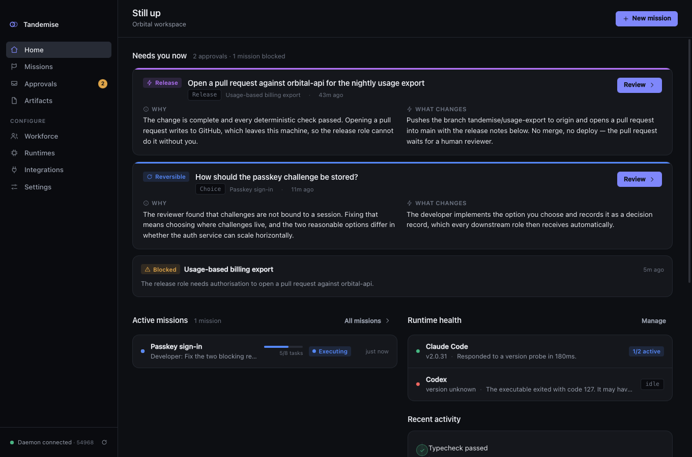

# Tandemise

[](https://github.com/tandemise/tandemise/actions/workflows/ci.yml)
[](https://github.com/tandemise/tandemise/releases/latest)
[](LICENSE)
[](https://tandemise.github.io/tandemise/)

*An open-source, self-hosted AI software factory that runs on your machine.*

Work comes in from your trackers and sources (YouTrack, GitHub Issues, Sentry,
PostHog, Slack, Discord, or a runner of your own) and is filed once in your
project's primary tracker. Nothing runs until you press **Start**; then the
task runs on its own, with as much process as its risk needs, up to a pull
request, and you can **Hold** any step and work with the agent in the real
Claude Code terminal before handing it back. The project learns from your
corrections through a shared brain repository, merges by measured risk (auto-merge
is off until you turn it on), and can share "who is working on what" with a
team through an optional relay you host yourself. The agents run on your
machine, under your own subscriptions and logins, and Tandemise's state lives
in `~/.tandemise`; there is no Tandemise cloud service.



## Contents

- [Install](#install)
- [Quick start](#quick-start)
- [A normal day](#a-normal-day)
- [How it works](#how-it-works)
- [Architecture](#architecture)
- [Documentation](#documentation)
- [Repository layout](#repository-layout)
- [Contributing](#contributing)

## Install

Installers are attached to each GitHub Release, built by the
[Desktop packages](.github/workflows/desktop-packages.yml) workflow on Linux,
macOS and Windows runners. Download the one for your platform from the
[latest release](https://github.com/tandemise/tandemise/releases/latest):

| Platform | File |
| --- | --- |
| macOS, Apple Silicon | `Tandemise-<version>-mac-arm64.dmg` |
| macOS, Intel | `Tandemise-<version>-mac-x64.dmg` |
| Linux | `Tandemise-<version>-linux-x86_64.AppImage`, or `Tandemise-<version>-linux-amd64.deb` for Debian and Ubuntu |
| Windows | `Tandemise-<version>-win-x64-setup.exe` |

v0.9.0 was published before the packaging workflow existed and has no
installers; releases after it carry them. To use v0.9.0, run it
[from source](#from-source).

The app carries its own daemon and runs it on its own built-in Node, so you do
not need Node.js installed. You still need `git`, and the agent CLIs you want to
use (Claude Code, Codex, …) on your `PATH`. `gh`, signed in, is needed for pull
requests, GitHub Issues and a brain on GitHub.

- **Linux AppImage:** `chmod +x Tandemise-*.AppImage` and run it. It needs FUSE
  (`sudo apt install libfuse2` on Ubuntu). Without FUSE, run it as
  `NO_CLEANUP=1 ./Tandemise-*.AppImage --appimage-extract-and-run`: the daemon
  keeps running from the extracted copy after the window closes, and
  `NO_CLEANUP=1` stops the AppImage from deleting that copy under it (when the
  window closes, or when a second launch exits).
- **Linux .deb:** `sudo apt install ./Tandemise-*-linux-amd64.deb`, then start
  Tandemise from your applications menu (or `tandemise`).
- **macOS and Windows:** the builds are not signed yet, so the system warns that
  the developer cannot be verified. On macOS, right-click the app and choose
  **Open** the first time; on Windows, choose **More info → Run anyway**.

The daemon keeps running when you close the window, so missions carry on, and
the next window you open reconnects to it. After an update, the new app stops
the old daemon and starts its own. Everything it stores lives in
`~/.tandemise`. Tokens you give it (a YouTrack token, a source's secret) go
in the macOS Keychain; on Linux and Windows there is no OS credential store
support yet, and they are kept in a plain file, `~/.tandemise/secrets.json`
(mode `0600`).

### From source

Tandemise needs **Node 22** (see `.nvmrc`). On Linux, `npm install` compiles
`node-pty` and needs `g++`, `make` and `python3`.

```bash
git clone https://github.com/tandemise/tandemise.git
cd tandemise
nvm use                 # 22.23.1, per .nvmrc
npm install
npm run build

npm run dev             # starts tandemd, then the desktop app
# or, as two processes:
npm run daemon          # tandemd on 127.0.0.1
npm run desktop         # the Electron app
```

## Quick start

1. **Add a repository.** Point Tandemise at a Git repository. Claude Code is
   detected on **Runtimes**; any other CLI can be added there as a generic
   runtime without code.
2. **Give the project a tracker.** In **Settings → Intake**, choose YouTrack
   (address, project, a permanent token) or a repository's GitHub Issues, and
   map its states (ready, in progress, in review, done, won't do). Add sources
   there too: GitHub issues, Sentry, PostHog, Slack, Discord, or a custom runner.
3. **Link a brain (optional).** In the project's **Brain** section: create a
   private repository on GitHub with your `gh`, use one a teammate made, or
   keep it on this machine.
4. **Start something.** Open **Board**, press **Start** on a ready item (or
   write a one-sentence request in **New mission**), and follow it from the
   Plan tab.

[docs/QUICKSTART.md](docs/QUICKSTART.md) has the details, including the
`tandemise` CLI for custom runners.

## A normal day

This is the path `scratch/acceptance/integrated/run-all.mjs` drives in the real
window, on one install, with fakes for YouTrack, GitHub and the agent
([report](docs/superpowers/evidence/2026-10-31-integrated/REPORT.md)).

1. **Work arrives.** A form reply is pushed with `tandemise intake push`. It is
   filed in YouTrack as `GAR-2` and shows on the **Board** under Ready. A
   signal that matches an existing item is linked instead; noise is held back
   with the reason; an unsure match becomes one Inbox question ("Is this the
   same as GAR-7?").
2. **You start it.** **Start** opens a mission. The factory profiles the item
   as a tiny, low-risk fix and puts it in the quick lane: one step, then a pull
   request, with no plan approval. **Why these steps** on the Plan tab says
   so. YouTrack moves the item to In Progress and gets one activity comment that
   Tandemise keeps up to date.
3. **It runs.** The step runs on the agent staffed for it, in its own Git
   worktree on its own branch, not in your checkout.
4. **You hold it.** **Hold** stops the run and opens the agent's own session in
   a terminal in the task panel, in the same worktree. You type to it; it edits
   files. **Continue** hands the step back and it finishes from the work as it
   now stands, without spending another attempt.
5. **A pull request.** The ship step opens one pull request with the agent's
   change and yours, waits for CI, and decides. Auto-merge is off, so the
   Inbox gets **Review and merge** and YouTrack moves to In Review.
6. **The team sees it.** Home's **Who's working on what** shows `GAR-2` as
   yours; with a relay, every teammate sees the same.

With a brain linked, what you corrected during the hold becomes a short lesson
that the next run on that kind of step loads.

## How it works

### Intake into one tracker

Each project has one primary tracker: YouTrack or GitHub Issues. Sources
(GitHub issues labelled for it, Sentry, PostHog, Slack and Discord threads, or a
runner of your own) send signals that are filed there once. Everything that
comes in is recorded, but nothing starts until a person starts it. When the
item is done, the loop closes at every source it came from. Custom runners push
with a per-source token through the `tandemise` CLI (`tandemise intake push`,
`tandemise intake closures`, `tandemise start GAR-12`) or over HTTP. See
[Writing an intake runner](docs/intake/README.md).

### The planner: lanes, steps and models

With **Let the factory decide** (the default workflow), a task is planned by
rules, not by a model. It is profiled (type, size, risk) from the tracker item
and the areas of code it names; a lane follows: *quick* (one step, then a pull
request), *standard* (adds an independent review, and verification when the
task has Done-when lines) or *careful* (spec, architecture, implement, review,
verify, a plan you approve, and a pull request that always asks). Modules add
steps for sensitive areas, such as a security review for auth. Each step class
can have a ladder of models: a step starts on the cheapest model with a good
enough record for similar work and climbs on retry. Every choice is shown with
its reasons. See [The factory](docs/FACTORY.md).

### Merge by risk

The ship step opens the pull request, waits for CI, and either asks you or
merges it. It decides from facts it measured at the pull request's head commit
(CI state, lines changed, the areas touched, whether a person committed, the
repository's branch protection), never from what an agent wrote. **Auto-merge
is off by default.** It can only be turned on by a person, in the app, for a
project with a brain, after a backtest of past decisions. Even then, anything
on `merge.yaml`'s `never` list always asks; the built-in list covers
migrations, CI and infrastructure files, secrets, auth and payments code, the
careful lane, and a branch with a person's commit on it. Every merge is bound to the decided commit and
can be reverted from its card.

### Hold and interact

**Hold** any running or waiting agent step. Tandemise stops the run cleanly
and opens the agent's own session in an in-app terminal, in the same checkout.
**Continue** resumes the pipeline from the work as it now stands; **Release**
ends the hold and keeps what you did without resuming the session. Hold needs
a runtime that can resume a session interactively: today, Claude Code.

### The brain

Each project can link one git repository as its brain. It holds the factory
definition (`factory/planner.yaml`, `routing.yaml`, `merge.yaml`, the tracker
and intake settings) and what the project has learned: a ledger of lessons
from holds and requested changes, with a link to the run each came from. A run
loads only the lessons relevant to its step, and the task shows what it knew. A
lesson that keeps helping is proposed as a rule through a pull request to the
brain. Sharing is `git pull` and `git push`; secrets and personal settings
never go in it.

### Optional relay for teams

Solo needs no server. A team can run a slim relay with Docker Compose: one
container, one SQLite file. It tells every connected Tandemise who is working
on which tracker item, keeps the team's members and per-computer tokens, and
holds webhooks for a daemon to pick up. It runs no agents and stores no work;
losing it never stops local work. See [apps/relay/README.md](apps/relay/README.md).

### The engine underneath

Every mission is a plan of tasks across roles (product, architecture,
development, review, QA, release), each in an isolated Git worktree, handing
off typed artifacts (`ProductSpec`, `ChangeSet`, `ReviewReport`, …) and passing
gates measured from facts (`checks.typecheck == PASS && review.blocking_findings
== 0`). Around it sit Done-when criteria verified one by one, a backlog with a
work-in-progress limit, spend and time limits, an Inbox for anything stuck,
routines, skills pinned to roles, and your setup kept as files in the
repository. Each has a guide in [docs/guides/](docs/guides/).

The daemon decides from stored facts and fixed rules; no model output decides
whether work is done, planned, stopped or stuck.

## Architecture

```
┌──────────────────────────────────────────────────────────────┐
│  apps/desktop        Electron + React. Control surface only.  │
│                      State lives in the daemon.               │
└───────────────────────────┬──────────────────────────────────┘
                            │  HTTP + WebSocket on 127.0.0.1,
                            │  bearer-authenticated
┌───────────────────────────▼──────────────────────────────────┐
│  apps/daemon (tandemd)    The authoritative process.          │
│                           Composition root: the only place    │
│                           that names a concrete provider.     │
└───────────┬───────────────────────────────────┬──────────────┘
            │                                   │ optional, HTTPS + WebSocket
┌───────────▼──────────────────────────────┐  ┌─▼──────────────────────┐
│  packages/application  Mission engine,   │  │  apps/relay            │
│  planner, merge policy, intake, brain,   │  │  who works on what,    │
│  hold. Depends on ports, not providers.  │  │  members, webhooks     │
├──────────────────────────────────────────┤  └────────────────────────┘
│  packages/domain, kernel, shared         │
│  Entities, events, gate language, ports. │
├──────────────────────────────────────────┤
│  Providers (outward)                     │
│    runtime-claude · runtime-codex · runtime-generic                  │
│    execution-local · persistence · artifacts · terminal             │
│    integration-github · integration-youtrack · integration-mcp      │
│    intake-runners · coordination · coordination-relay · browser     │
└──────────────────────────────────────────┘
```

`npm run check:boundaries` fails the build when a package under `packages/`
imports something it has not declared or from an equal or higher layer, when a
core package imports a provider module (`electron`, `playwright`,
`better-sqlite3`, `child_process`, …), when the desktop renderer value-imports
a `@tandemise/*` package that pulls in Node built-ins, or when `apps/relay`
imports anything beyond its short allowlist. It does not check the desktop's
main process or the daemon: that the desktop holds no state is kept by design
and review.

Why it is shaped this way, in short: runtimes are adapters routed by
capability, so replacing an agent CLI changes one adapter; roles hand off typed
artifacts, so a reviewer reads the diff and the spec, never the implementer's
transcript; gates are measured facts; permissions are default-deny per worker
assignment; and the daemon outlives the window and recovers interrupted runs.
The decisions are recorded in [docs/adr/](docs/adr/).

## Documentation

- [docs/README.md](docs/README.md) is the map of every document.
- [docs/QUICKSTART.md](docs/QUICKSTART.md): run it and do the first task.
- [docs/guides/](docs/guides/): one guide per feature.
- [docs/FACTORY.md](docs/FACTORY.md): lanes, model routing and merge rules.
- [docs/intake/README.md](docs/intake/README.md): write an intake runner.
- [apps/relay/README.md](apps/relay/README.md): run the team relay.
- [docs/KNOWN_LIMITATIONS.md](docs/KNOWN_LIMITATIONS.md): what is not done yet.
- [Storybook](https://tandemise.github.io/tandemise/): the design system
  (`@tandemise/design`) with every component and its states, in light and dark.
  WCAG 2.1 AA is the minimum: CI runs axe on every story in both themes. See
  [docs/DESIGN_SYSTEM.md](docs/DESIGN_SYSTEM.md).

## Repository layout

| Path | What lives there |
|---|---|
| `apps/daemon` | `tandemd`: HTTP/WS API, composition root, lifecycle |
| `apps/desktop` | Electron main/preload + React renderer, and the installer build |
| `apps/relay` | The optional, self-hosted team relay (`node:http` + `ws` + SQLite), its CLI, Dockerfile and compose file |
| `packages/shared` | Branded ids, errors, `Result`, clock, logging, secret redaction, path scoping |
| `packages/kernel` | Typed service tokens, the IoC container, modules, the capability registry |
| `packages/domain` | Entities, event vocabulary, gate language, plan validation, all ports |
| `packages/api-contract` | The daemon's HTTP/WS request and view schemas, the intake signal schema, the relay's wire schema |
| `packages/application` | Mission engine, planner, merge policy, intake, brain, hold, routines and the other services |
| `packages/policy` | Risk classification, permission decisions, grants, trust boundaries |
| `packages/persistence` | SQLite (WAL) repositories and migrations |
| `packages/artifacts` | Content-addressed artifact store and artifact schemas |
| `packages/context` | The context compiler: the smallest task-relevant prompt |
| `packages/evaluation` | Deterministic checks and the gate fact vocabulary |
| `packages/runtimes-core` | The runtime adapter contract, registry and capability router |
| `packages/runtime-claude`, `runtime-codex`, `runtime-generic` | Claude Code, Codex, and any CLI by configuration (plus the scripted fake runtime) |
| `packages/execution-core`, `execution-local` | Execution target contract, process supervisor, scoped filesystem; local worktrees |
| `packages/terminal` | The pty (`node-pty`) behind a hold, and its scrollback |
| `packages/integrations-core` | Tool broker, run-scoped tool gateway, MCP gateway |
| `packages/integration-github` | `gh`: pull requests, issues, GitHub Issues as a primary tracker |
| `packages/integration-youtrack` | YouTrack as a primary tracker |
| `packages/integration-mcp` | MCP servers (stdio and HTTP, with OAuth) as integrations |
| `packages/intake-runners` | Built-in intake runners: Sentry, PostHog, Slack, Discord |
| `packages/coordination` | Who works on which tracker item: claims, take-over rules, the webhook mailbox, local (solo) mode |
| `packages/coordination-relay` | The daemon's client for a team relay: mirror, outbox, stream |
| `packages/design` | `@tandemise/design`: tokens (CSS, TypeScript, Tailwind), theme, logo, icons and React components ([README](packages/design/README.md)) |
| `packages/browser`, `desktop-control` | Browser automation for QA; macOS app control through `native/macos-helper` |
| `native/macos-helper` | Swift helper for Accessibility, screen capture and input |
| `docs/` | Guides, quickstart, factory and workflow references, design system, ADRs, specs, plans and evidence ([map](docs/README.md)) |
| `scratch/` | Offline checks (`*-check.mjs`), real-app acceptance suites (`acceptance/`), screenshot scripts |

`MVP.md` is the original product and architecture specification. The pivot to
the software factory is described in
[docs/superpowers/specs/2026-10-30-tandemise-pivot-notes.md](docs/superpowers/specs/2026-10-30-tandemise-pivot-notes.md)
and the specs next to it.

## Origins

Tandemise started as a private tool built for one job: helping me build
[Beveloce](https://beveloce.com), an AI cycling coach, with a team of agents
instead of a single chat window. Once it was running real missions every day, I
cleaned it up, took out everything specific to that one product, and released
it as open source so any developer can use it, extend it, and plug in their own
agents, tools, and machines.

## Inspiration

Tandemise borrows most of its shape from projects working out how people and
agents get real work done together:

- **[Grok Bot](https://x.ai/bot)** treats agents as persistent teammates that
  keep working on their own and come back only when something needs your
  approval. Tandemise's approvals, its Inbox, and its routines follow that model.
- **[Paperclip](https://github.com/paperclipai/paperclip)** showed that the
  interesting layer sits above the agents: an organization with roles, goals,
  budgets and governance that runs whatever agents you already have. The roles
  and the spend and time limits come from there.
- **[Buzz](https://buzz.xyz)** puts people and agents in the same workspace as
  equals, without locking you into one vendor's models. Tandemise borrows its
  owned-agent model (every agent has a person who answers for its work),
  owner-reviewed drafts, human steps in workflows, and runtimes as replaceable
  adapters.
- **[Hermes Agent](https://github.com/NousResearch/hermes-agent)** builds
  skills from experience and remembers what it has done. The idea that what a
  project learns should outlive any single agent or session comes from there.

Thank you to the people behind each of them.

## Contributing

Contributions are welcome. Read [CONTRIBUTING.md](CONTRIBUTING.md) for the
workflow (Conventional Commit PR titles, squash merges, automated releases, the
checks to run) and [SECURITY.md](SECURITY.md) for reporting vulnerabilities.

## License

Tandemise is licensed under the [Apache License 2.0](LICENSE).
